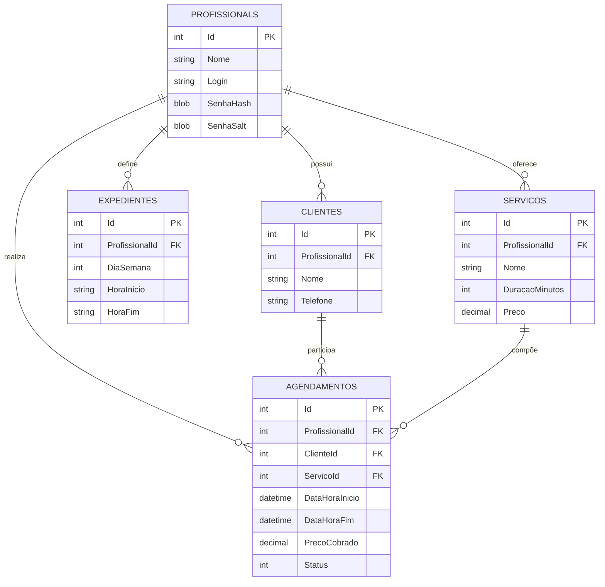

## Modelagem do Banco de Dados (Diagrama ER)

A aplicação utiliza **SQLite** com **Entity Framework Core**, isolando todos os registros por `ProfissionalId` (multi-tenancy por profissional autenticada via JWT).

### Regras de Integridade e Histórico
* **Exclusão em Cascata (`Cascade`):** Ao remover uma profissional, seus clientes, expedientes e serviços vinculados são removidos automaticamente.
* **Exclusão Restrita (`Restrict`):** Clientes e serviços que possuem agendamentos vinculados não podem ser excluídos (`409 Conflict`), preservando a integridade do histórico.
* **Congelamento de Preço (`PrecoCobrado`):** O valor do serviço é copiado para o agendamento no momento da criação, garantindo que reajustes futuros na tabela de preços não alterem o histórico financeiro de atendimentos anteriores.
* **Índice Único de Expediente:** Cada profissional pode cadastrar apenas um expediente por dia da semana (`ProfissionalId + DiaSemana`).
